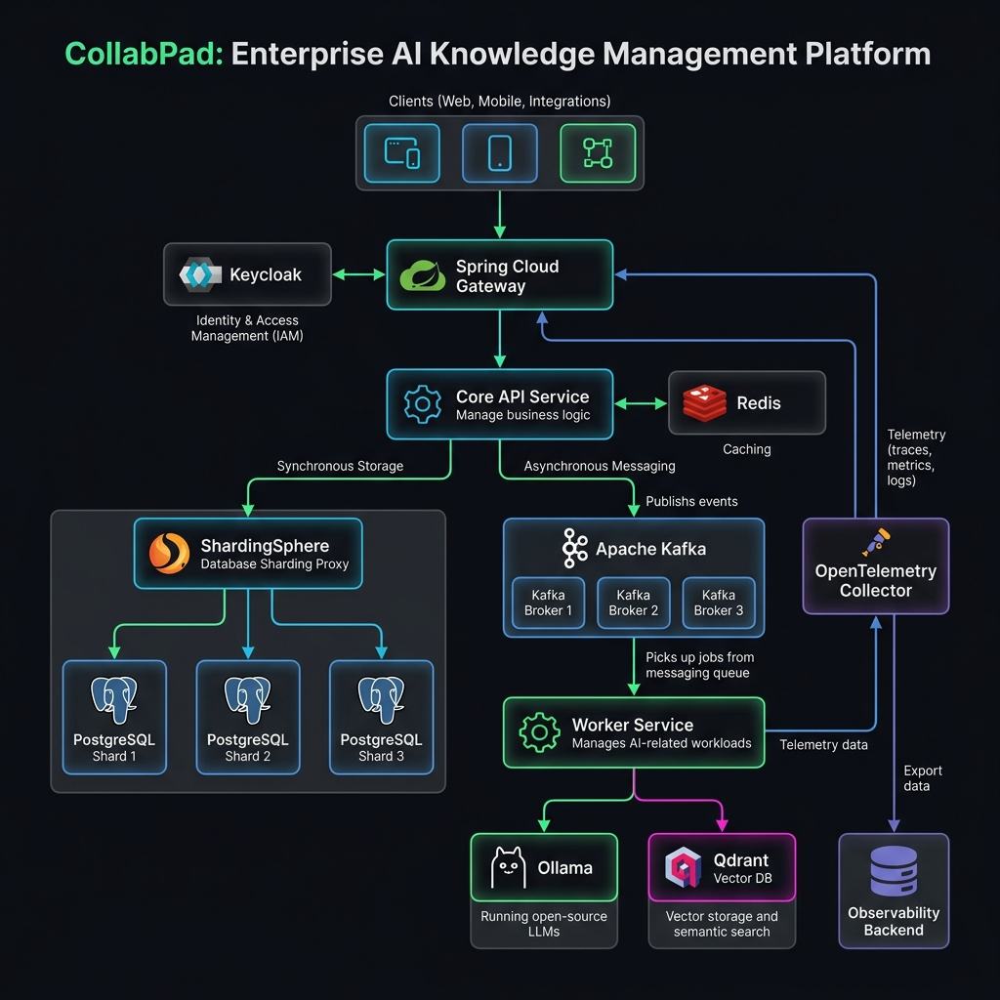

# CollabPad

**CollabPad** is an in-development multi-tenant SaaS knowledge-management platform. It provides hierarchical document authoring and departmental workspaces within a cohesive distributed system. Built with scalability and performance in mind, this project demonstrates modern architectural patterns including robust multi-tenancy and OAuth2 security.

## 🏗️ Architecture Overview

The platform is designed as a distributed system capable of handling strict data isolation across multiple tenants. The core flow involves a React frontend communicating directly with a Spring Boot Core API backed by a multi-tenant PostgreSQL database.



## 🚀 Engineering Highlights

* **Public Multi-Tenant SaaS Architecture:** A  multi-tenancy model with self-serve onboarding, strict data segregation in PostgreSQL, and automated tenant provisioning.
* **Hierarchical Document Management:** Core REST APIs for managing nested, recursive document trees and departmental workspaces.
* **Advanced Access Control:** Multi-tenant user provisioning and session authentication using Clerk (OAuth2 / OIDC).
* **Direct Resource Server Security:** Centralized JWT validation, tenant resolution, and CORS management directly on the Spring Boot Core API.

## 🧠 System Design & Data Models

CollabPad is built around **Multi-Tenancy**, ensuring that multiple organizations can use the application simultaneously while keeping their data completely separate and secure. 

### Core Entities (Data Models)
* **`Tenant`**: Represents an organization or company using the platform.
* **`User`**: Represents a person belonging to a Tenant. Roles include `ROLE_COMPANY_ADMIN`, `ROLE_WORKSPACE_ADMIN`, `ROLE_MEMBER`, and `ROLE_VIEWER`.
* **`Workspace`**: A departmental space (e.g., "Engineering", "HR") within a Tenant for collaboration.
* **`Document`**: A page created inside a workspace. Documents support infinite nesting via a `parentDocument` self-referential relationship, enabling folder-like tree structures. Documents include rich metadata like icons, cover images, and positional ordering.

### Core Endpoints
The backend exposes RESTful APIs to manage the platform's state:
* **Onboarding (`/api/v1/onboarding`)**: 
  - `POST /enroll`: Registers a new company, creates the admin user, and automatically provisions initial departmental workspaces and welcome documents.
* **Workspaces (`/api/v1/workspaces`)**: 
  - `GET /`: Identifies the user's organization via JWT and returns all authorized workspaces.
* **Documents (`/api/v1/documents`)**: 
  - CRUD operations for documents within a workspace.
  - `GET /tree`: Retrieves documents formatted as a hierarchical tree structure based on their parent-child relationships, sorted by `positionOrder`.

## 🛠️ Tech Stack

* **Backend:** Java 17, Spring Boot 3.4+, Hibernate / JPA
* **Frontend:** React 19, Vite, Axios
* **Database:** Cloud PostgreSQL (Neon.tech with `pgvector`)
* **Identity & Access Management:** Clerk (OAuth2 / OpenID Connect)
* **Deployment:** Docker on Render (Backend) & Vercel Edge CDN (Frontend)

## 📂 Project Structure

* `collabpad/`: The Core API Spring Boot service for tenant onboarding, workspace management, and document hierarchies.
* `frontend/`: The React + Vite client providing the workspace UI.
* `docs/`: Architecture documentation and migration guides.
* `assets/`: Publicly tracked media and architecture diagrams.

## 🏁 Getting Started

### Prerequisites

Ensure you have the following installed:
* [Java 17+](https://adoptium.net/)
* [Node.js 20+](https://nodejs.org/)

### 1. Configure Environment
Set up your `.env` with your Neon database credentials and Clerk keys (see `.env.example`).

### 2. Start the Backend Service
Navigate to the backend service directory and start it using Maven:

**Core API:**
```bash
cd collabpad
./mvnw spring-boot:run
```

### 3. Start the Frontend Application
Navigate to the frontend directory, install dependencies, and start the development server:

```bash
cd frontend
npm install
npm run dev
```
