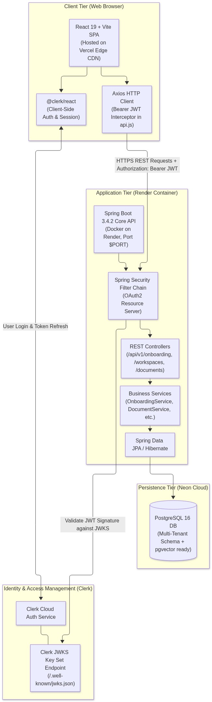
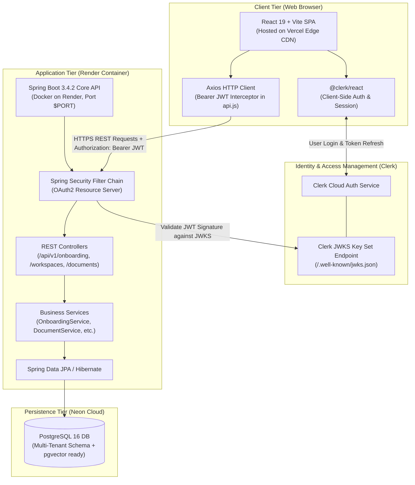
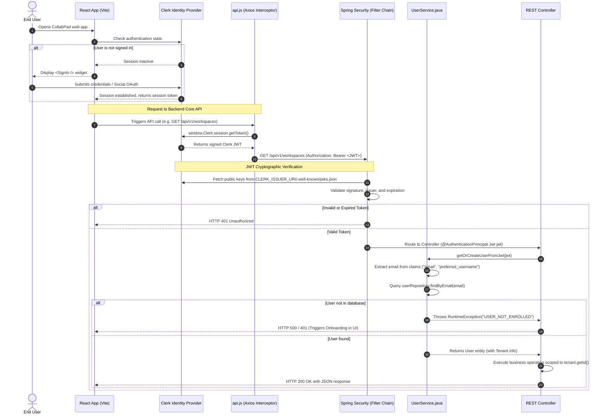
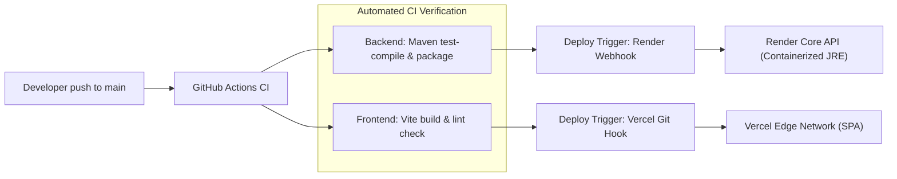

# CollabPad — System Architecture Specification

> **Module:** System Architecture & Topology  
> **Last Verified:** Current `main` branch  
> **Related Documents:** [Database Schema](database_schema.md) | [Comprehensive Architecture & Workflows](architecture_and_diagrams.md)

---

## 1. System Topology Overview

CollabPad is a modern multi-tenant SaaS knowledge management platform built on a decoupled, cloud-native architecture. The client SPA authenticates users through Clerk, forwards short-lived JWTs to the Spring Boot Core API, and the backend verifies the tokens directly against Clerk's JWKS endpoint before scoping all queries to the user's tenant in PostgreSQL.

▶ View Mermaid Diagram Source

---

## 2. Tier Breakdown

### 2.1 Client Tier (React 19 + Vite)
* **Hosting:** Vercel Edge CDN with global edge caching and automatic SSL.
* **Authentication Interceptor:** An Axios interceptor in `src/api.js` intercepts every outgoing HTTP request, dynamically fetches an active session JWT from `@clerk/react`, and injects `Authorization: Bearer <JWT>` into headers.
* **UI Components:**
  * `Sidebar.jsx`: Dynamic tree hierarchy navigation, workspace switcher, and mobile drawer.
  * `Dashboard.jsx`: Workspace overview and flat/recent document cards.
  * `DocumentEditor.jsx`: Document reading and editing interface.
  * `OnboardingWizard.jsx`: Automated company registration modal for un-enrolled users.

### 2.2 Identity & Access Management (Clerk)
* Handles user authentication, social logins, passwordless magic links, and session lifecycles.
* Exposes a public JSON Web Key Set (JWKS) endpoint at `${CLERK_ISSUER_URI}/.well-known/jwks.json`.
* Eliminates the need to store passwords or implement bespoke token rotation in the backend.

### 2.3 Application Tier (Spring Boot 3.4.2)
* **Runtime:** Containerized Eclipse Temurin Alpine JRE 17 running on Render.
* **Security Layer:** Spring Security operates as an **OAuth2 Resource Server**, cryptographically validating JWT signatures against Clerk's JWKS key discovery endpoint.
* **Tenant Scoping:** `UserService.getOrCreateUserFromJwt(jwt)` maps claims to the tenant boundary. Every subsequent repository query and mutation is strictly filtered by `tenant_id`.

### 2.4 Persistence Tier (PostgreSQL on Neon)
* Serverless PostgreSQL 16 hosted on Neon with connection pooling.
* Enforces row-level isolation via non-nullable `tenant_id` foreign keys on core tables.
* Structured relational indexing on `(workspace_id, tenant_id)` and self-referential `parent_document_id`.

---

## 3. End-to-End Authentication & Authorization Lifecycle

---

## 4. First-Time User Onboarding Lifecycle

---

## 5. CI/CD & Deployment Architecture

