# CollabPad — System Architecture, Workflows & Diagrams

> **Target Audience:** New engineers, contributors, and technical stakeholders onboarding onto CollabPad.  
> **Repository:** Monorepo containing Spring Boot backend (`collabpad/`) and React Vite frontend (`frontend/`).  
> **Related Document:** [Database Schema & ERD](database_schema.md)  
> **Image Assets:** High-resolution PNGs and vector SVGs available in `docs/images/`.

---

## 1. System Overview & Deployment Topology

CollabPad is a modern multi-tenant SaaS knowledge management platform. It uses a decoupled client-server architecture where the frontend interacts directly with the Spring Boot backend using OAuth2 JWT authentication provided by Clerk.

▶ View Mermaid Diagram Source Code

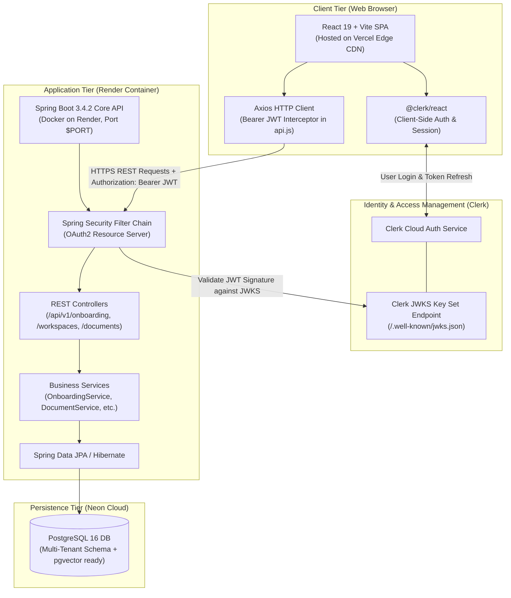

---

## 2. Entity-Relationship Data Model (ERD)

The database enforces a **Row-Level Tenant Isolation** model. All core business data (`workspaces`, `documents`, `users`) contain a foreign key reference to `tenants.id`.

▶ View Mermaid Diagram Source Code

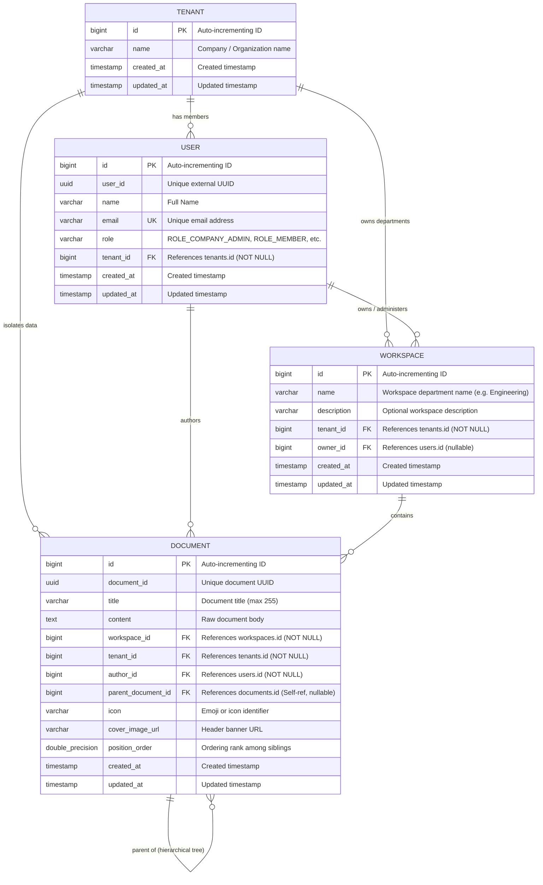

---

## 3. End-to-End Authentication & Authorization Flow

CollabPad uses Clerk for authentication and Spring Security Resource Server for token verification.

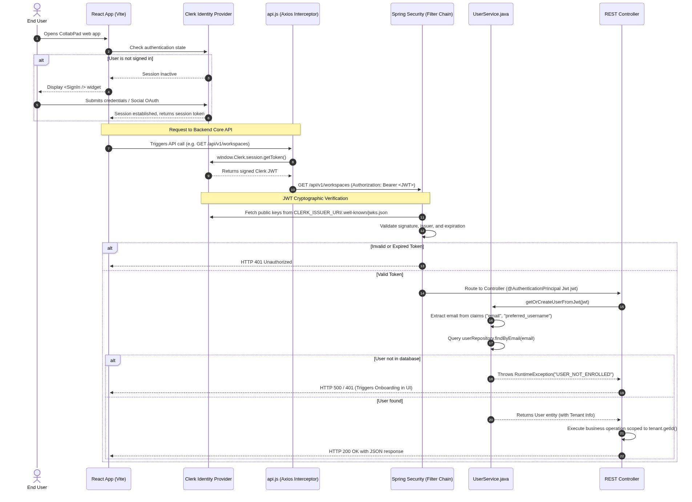

▶ View Mermaid Diagram Source Code

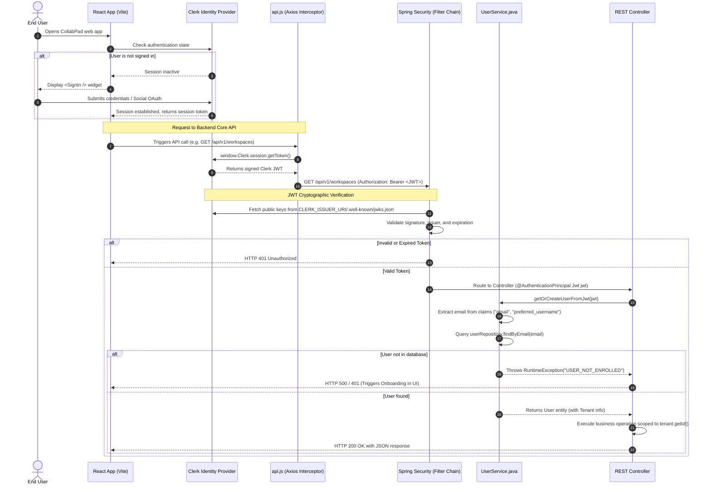

---

## 4. Multi-Tenant Onboarding Flow (First-Time User Experience)

When a brand new user registers with Clerk, they do not yet have a record in the database. The system detects this and triggers the `OnboardingWizard`.

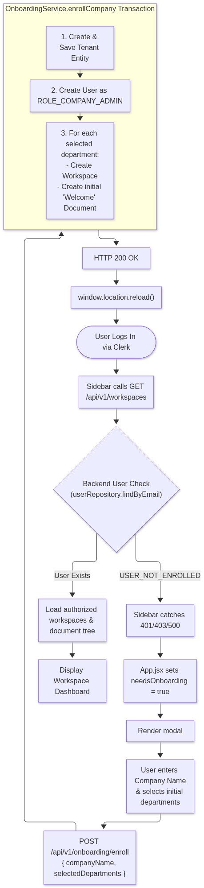

▶ View Mermaid Diagram Source Code

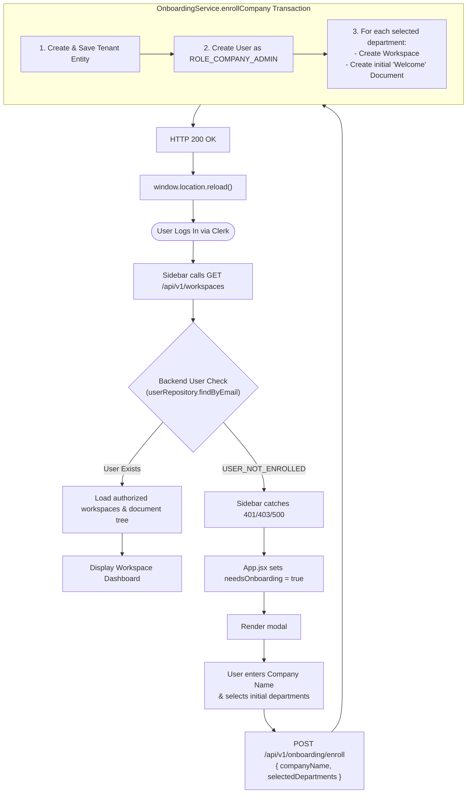

---

## 5. Hierarchical Document Tree: In-Memory Recursive Assembly

CollabPad stores hierarchical relationships relationally (`parent_document_id`), but the frontend needs an arbitrarily deep recursive tree node structure. The tree building logic lives in [`DocumentService.getDocumentTree`](file:///c:/sumith/projects/collab-pad/collabpad/src/main/java/com/sumith/collabpad/service/DocumentService.java#L101-L153).

### 5.1 Algorithm Flowchart

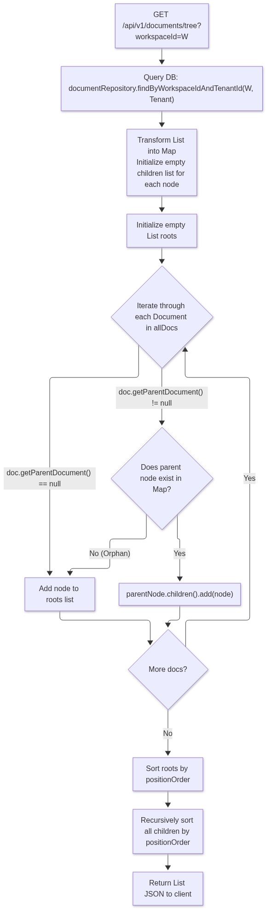

▶ View Mermaid Diagram Source Code

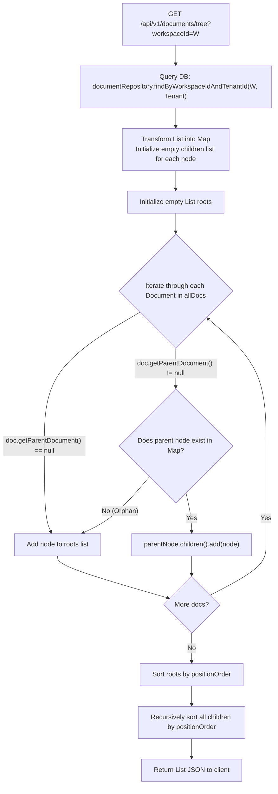

### 5.2 Tree Visual Representation

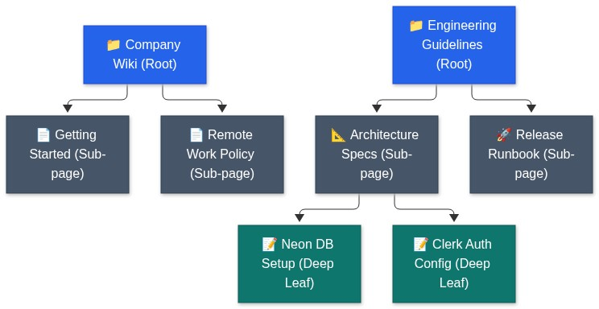

▶ View Mermaid Diagram Source Code

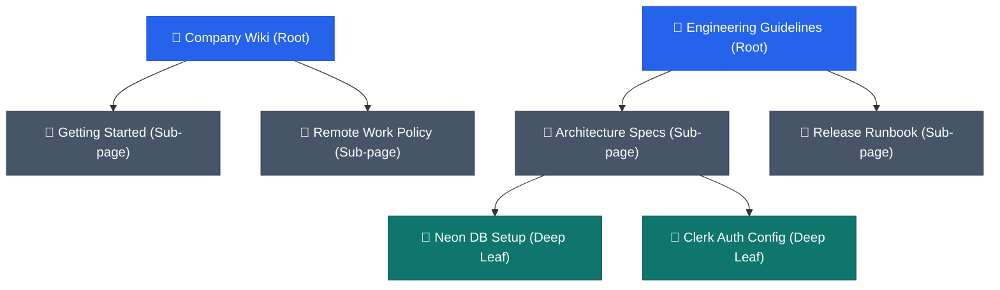

---

## 6. Document CRUD Operations & Tenant Security Isolation

Every single database query or mutation verifies that the resource belongs to the tenant stored in the user's JWT. Cross-tenant access attempts immediately fail.

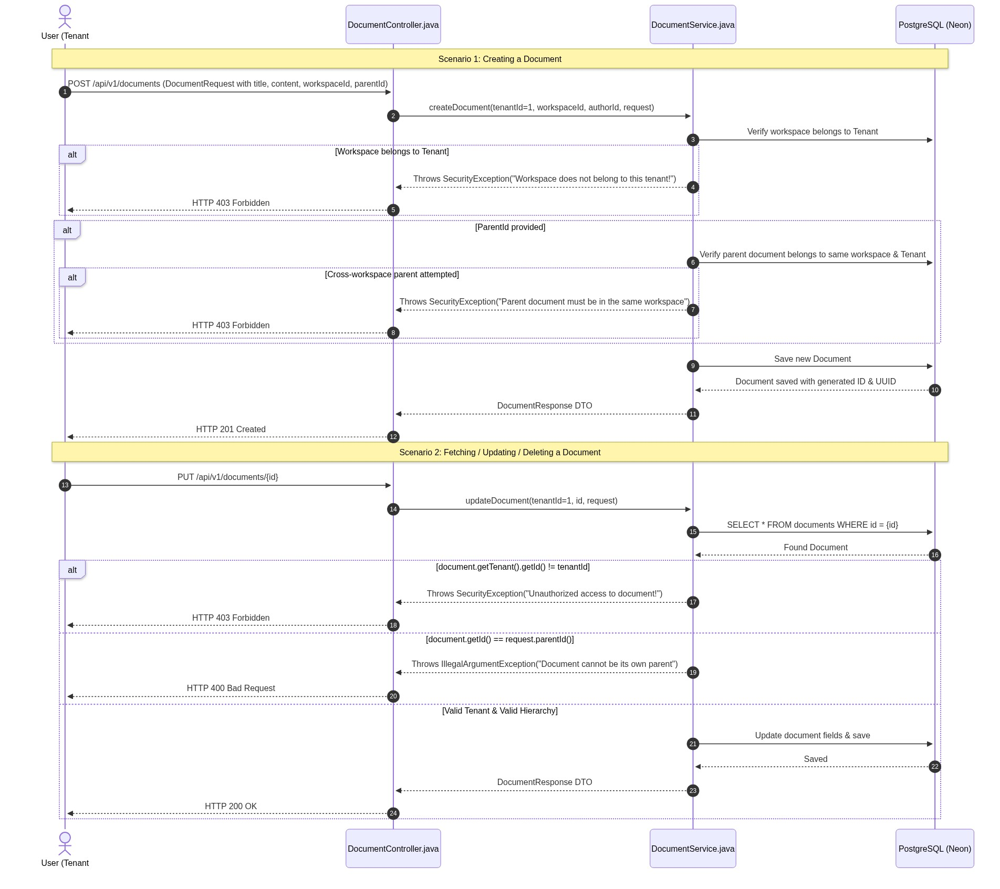

▶ View Mermaid Diagram Source Code

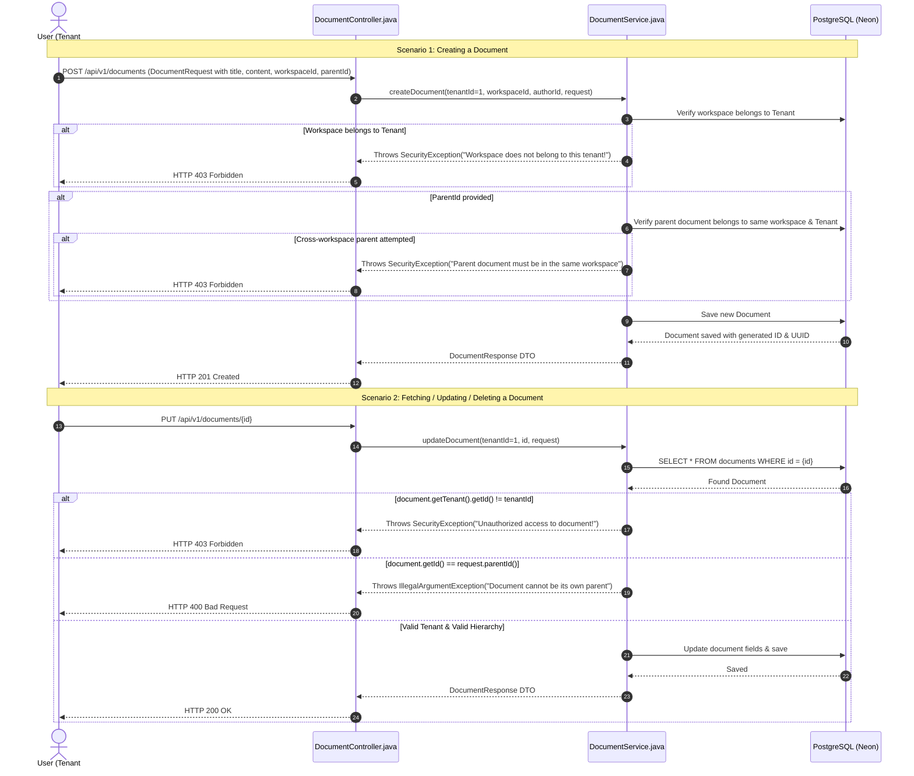

---

## 7. Frontend State Machine & UI Navigation

The React client state is managed primarily at the top level in [`App.jsx`](file:///c:/sumith/projects/collab-pad/frontend/src/App.jsx).

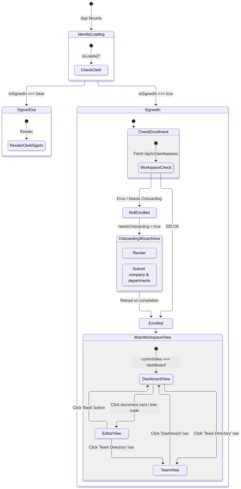

▶ View Mermaid Diagram Source Code

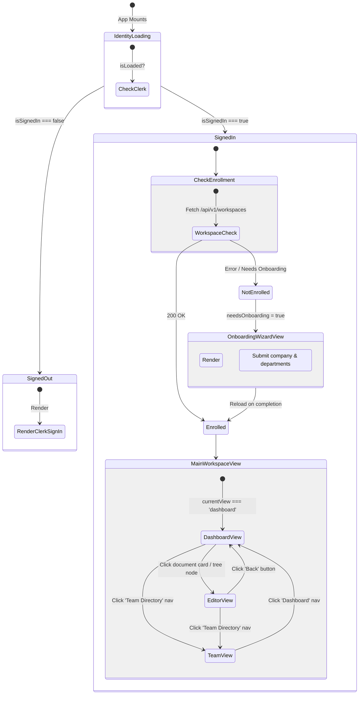

---

## 8. Backend Software Architecture (Layers & Responsibilities)

The Spring Boot backend strictly follows clean layered architecture principles:

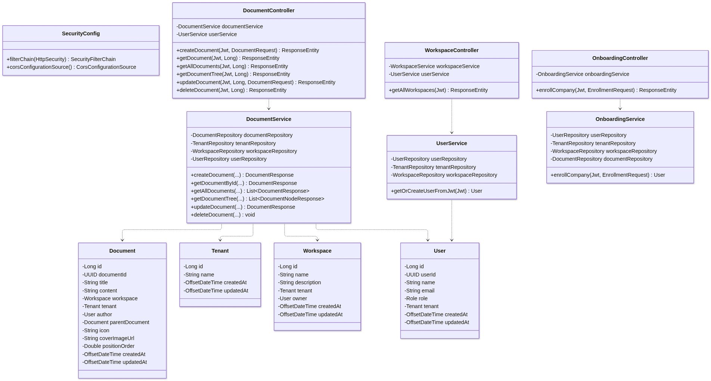

▶ View Mermaid Diagram Source Code

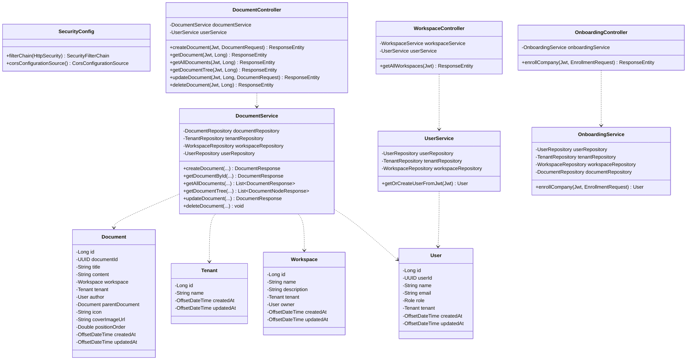

---

## 9. Summary Cheat Sheet for New Developers

| Question / Action | Location in Codebase |
| :--- | :--- |
| **How does authentication work?** | Frontend: `src/api.js` attaches Clerk JWT token. Backend: [`SecurityConfig.java`](file:///c:/sumith/projects/collab-pad/collabpad/src/main/java/com/sumith/collabpad/config/SecurityConfig.java) verifies with Clerk JWKS. |
| **Where is the user's company identified?** | [`UserService.java`](file:///c:/sumith/projects/collab-pad/collabpad/src/main/java/com/sumith/collabpad/service/UserService.java) resolves the `User` entity by email claim, granting access to `user.getTenant()`. |
| **How is document nesting represented?** | In DB: `documents.parent_document_id`. In Backend: [`DocumentService.java`](file:///c:/sumith/projects/collab-pad/collabpad/src/main/java/com/sumith/collabpad/service/DocumentService.java) transforms this to `DocumentNodeResponse` trees. In UI: [`Sidebar.jsx`](file:///c:/sumith/projects/collab-pad/frontend/src/components/Sidebar.jsx) renders recursive `TreeItem`s. |
| **How to run the system locally?** | Run PostgreSQL (or Docker `docker-compose up -d postgres`), then `./mvnw spring-boot:run` in `collabpad/`, and `npm run dev` in `frontend/`. |
