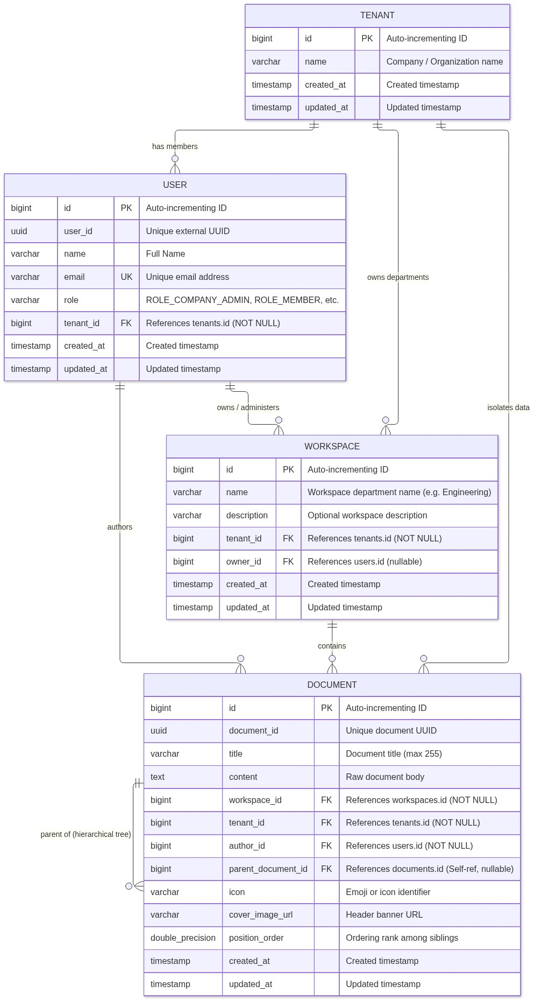
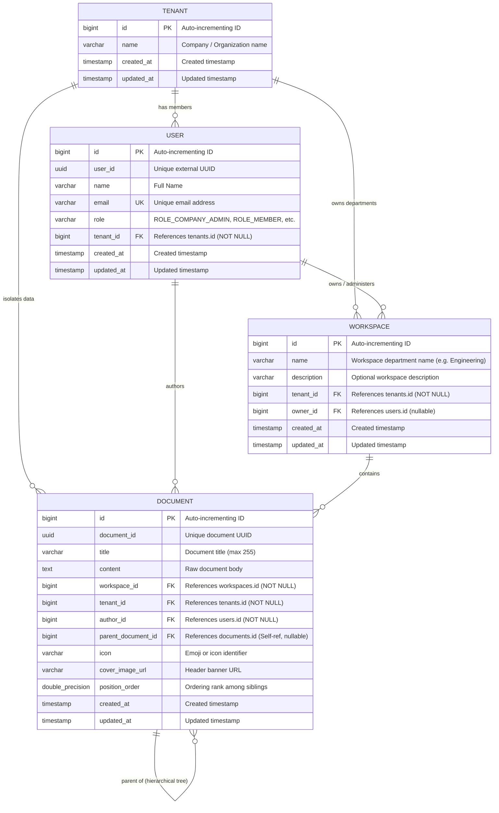

# CollabPad — Database Schema & Entity-Relationship Model

> **Module:** Persistence Tier & Multi-Tenant Schema  
> **Last Verified:** Current `main` branch  
> **Related Documents:** [System Architecture](architecture.md) | [Comprehensive Architecture & Workflows](architecture_and_diagrams.md)

---

## 1. Entity-Relationship Diagram (ERD)

CollabPad implements a **Row-Level Tenant Segregation** model in PostgreSQL. Rather than using complex multi-database or multi-schema configurations, every core entity maintains a non-nullable foreign key referencing `tenants(id)`.



<details>
<summary>▶ View Mermaid ERD Source</summary>


</details>

---

## 2. Table Definitions & Column Specifications

### 2.1 `tenants`
The root organization entity representing a registered company.
| Column | Type | Constraints | Description |
| :--- | :--- | :--- | :--- |
| `id` | `BIGSERIAL` | `PRIMARY KEY` | Internal surrogate primary key |
| `name` | `VARCHAR(255)` | `NOT NULL` | Company / tenant display name |
| `created_at` | `TIMESTAMPTZ` | `NOT NULL, DEFAULT NOW()` | Entity creation timestamp |
| `updated_at` | `TIMESTAMPTZ` | `DEFAULT NOW()` | Last update timestamp |

### 2.2 `users`
Company team members linked to a specific tenant.
| Column | Type | Constraints | Description |
| :--- | :--- | :--- | :--- |
| `id` | `BIGSERIAL` | `PRIMARY KEY` | Internal surrogate primary key |
| `user_id` | `UUID` | `NOT NULL, UNIQUE` | Immutable external UUID |
| `name` | `VARCHAR(255)` | `NOT NULL` | User full name |
| `email` | `VARCHAR(255)` | `NOT NULL, UNIQUE` | Login email (synchronized via Clerk JWT claims) |
| `role` | `VARCHAR(50)` | `NOT NULL` | Role enum: `ROLE_COMPANY_ADMIN`, `ROLE_MEMBER`, `ROLE_VIEWER` |
| `tenant_id` | `BIGINT` | `NOT NULL, FK -> tenants(id)` | Strict tenant boundary constraint |
| `created_at` | `TIMESTAMPTZ` | `NOT NULL, DEFAULT NOW()` | Entity creation timestamp |
| `updated_at` | `TIMESTAMPTZ` | `DEFAULT NOW()` | Last update timestamp |

### 2.3 `workspaces`
Departmental collaborative spaces within a company (e.g., Engineering, Marketing).
| Column | Type | Constraints | Description |
| :--- | :--- | :--- | :--- |
| `id` | `BIGSERIAL` | `PRIMARY KEY` | Internal surrogate primary key |
| `name` | `VARCHAR(255)` | `NOT NULL` | Department or space name |
| `description` | `VARCHAR(500)` | `NULLABLE` | Optional workspace summary |
| `tenant_id` | `BIGINT` | `NOT NULL, FK -> tenants(id)` | Tenant ownership constraint |
| `owner_id` | `BIGINT` | `NULLABLE, FK -> users(id)` | Creator / departmental lead |
| `created_at` | `TIMESTAMPTZ` | `NOT NULL, DEFAULT NOW()` | Entity creation timestamp |
| `updated_at` | `TIMESTAMPTZ` | `DEFAULT NOW()` | Last update timestamp |

### 2.4 `documents`
The core authoring unit. Supports arbitrary infinite sub-page nesting via self-referential parent keys.
| Column | Type | Constraints | Description |
| :--- | :--- | :--- | :--- |
| `id` | `BIGSERIAL` | `PRIMARY KEY` | Internal surrogate primary key |
| `document_id` | `UUID` | `NOT NULL, UNIQUE` | Public external UUID |
| `title` | `VARCHAR(255)` | `NOT NULL` | Document title |
| `content` | `TEXT` | `NULLABLE` | Markdown or raw document content |
| `workspace_id` | `BIGINT` | `NOT NULL, FK -> workspaces(id)` | Departmental workspace container |
| `tenant_id` | `BIGINT` | `NOT NULL, FK -> tenants(id)` | Row-level tenant boundary |
| `author_id` | `BIGINT` | `NOT NULL, FK -> users(id)` | Author user reference |
| `parent_document_id` | `BIGINT` | `NULLABLE, FK -> documents(id)` | Self-referential parent page pointer |
| `icon` | `VARCHAR(50)` | `NULLABLE` | Emoji or icon identifier |
| `cover_image_url` | `VARCHAR(500)` | `NULLABLE` | Header banner image URL |
| `position_order` | `DOUBLE PRECISION` | `DEFAULT 0.0` | Sibling ordering rank |
| `created_at` | `TIMESTAMPTZ` | `NOT NULL, DEFAULT NOW()` | Entity creation timestamp |
| `updated_at` | `TIMESTAMPTZ` | `DEFAULT NOW()` | Last update timestamp |

---

## 3. Hierarchical Self-Referential Model

Documents achieve Notion-like nested sub-pages through the `parent_document_id` column:

```text
Root Document (id=1, parent_document_id=null)
 ├── Sub-Page A (id=2, parent_document_id=1)
 │    └── Deep Page (id=4, parent_document_id=2)
 └── Sub-Page B (id=3, parent_document_id=1)
```

* **No recursive SQL queries:** All documents for a workspace are fetched in a single indexed query (`findByWorkspaceIdAndTenantId`).
* **In-memory assembly:** Assembled into an arbitrarily deep nested tree by `DocumentService.getDocumentTree()` in $O(N)$ time.
* **Orphan safety:** Documents with deleted or non-existent parent IDs gracefully fall back to the root level.
