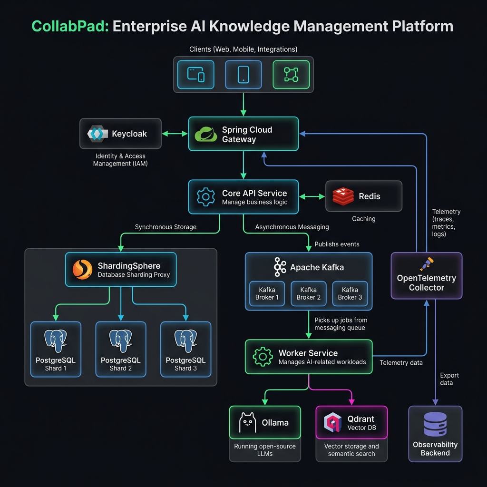
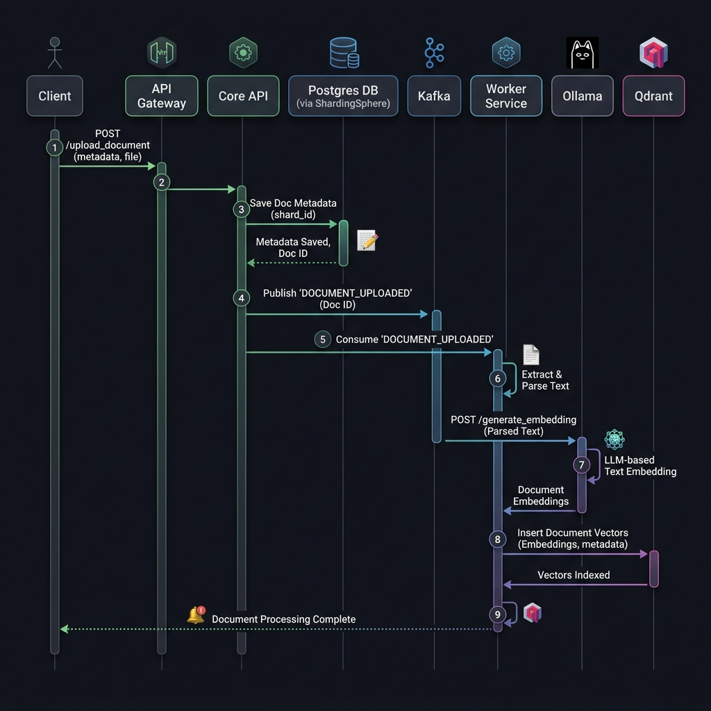
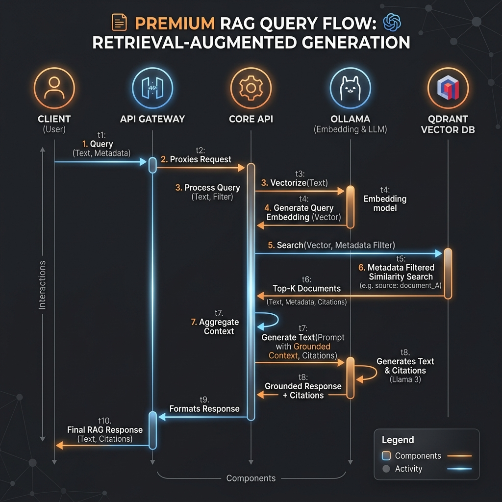
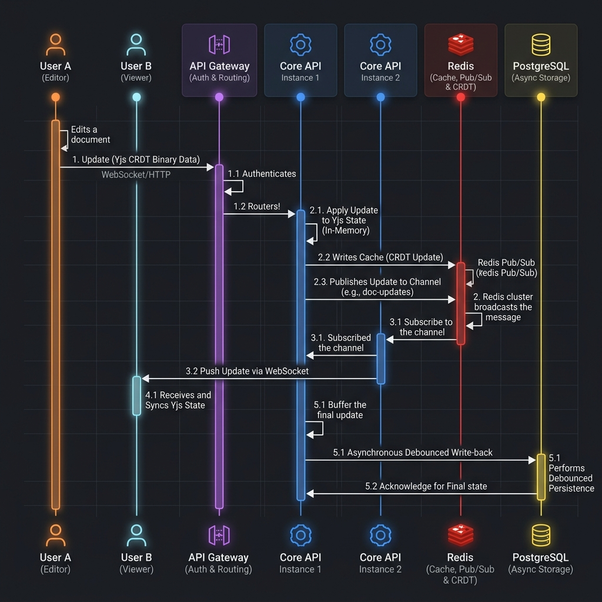

# CollabPad — System Architecture & Component Plan

This document outlines the System Architecture and Component Plan for **CollabPad**, an enterprise-grade, local-first, multi-tenant AI knowledge management platform.

It is designed to serve as the blueprint for the entire implementation, establishing boundaries, data flows, folder structures, and core engineering constraints.

---

## 1. High-Level Component Diagram

The following component diagram visualizes the interaction between the system's external boundaries, API gateway, core logic layers, event stream, persistent stores, AI infrastructure, and the observability stack.



---

## 2. Service Boundaries & Responsibilities

To achieve scalability and maintainable operations under load, the three key backend microservices are decoupled.

### 2.1 API Gateway (`api-gateway`)
The entry point for all client requests. It operates reactive Netty under the hood and coordinates cross-cutting edge concerns.

*   **Primary Responsibilities:**
    *   **Reverse Proxy & Routing:** Dynamic forwarding of traffic to `core-api` or WebSockets instances.
    *   **Tenant Authentication Checking:** Parsing incoming bearer JWTs, validating signatures, and extracting core claims (e.g., `tenant_id`, `roles`, `user_id`).
    *   **Atomic Rate Limiting:** Enforcing tenant, user, and IP rate limits using high-performance atomic Redis Lua scripts (token-bucket pattern) to avoid race conditions.
    *   **Resilience and Protective Shields:** Implementing circuit breakers, bulkheads, and retries via Resilience4j; filtering out malformed requests, enforcing payload size checks, and validating content types to prevent injection attempts.
*   **Anti-Patterns (What it should NEVER do):**
    *   *No Database Access:* Must not connect to PostgreSQL or ShardingSphere.
    *   *No Business Logic:* Must not modify domain state or validate deep business workflows.
    *   *No LLM/Vector Calls:* Must not call Ollama or Qdrant.

### 2.2 Core API Service (`core-api`)
The high-concurrency transaction engine. Running Spring Boot 3.4+ and configured for Java Virtual Threads to handle high numbers of concurrent requests.

*   **Primary Responsibilities:**
    *   **REST API Layer:** Exposing REST endpoints for workspace configuration, document metadata management, and AI search queries.
    *   **Tenant Data Isolation:** Enforcing tenant access boundaries at both the API level and the service layer.
    *   **WebFlux WebSocket Server:** Maintaining active WebSocket channels for collaborative document updates, relying on a Redis Pub/Sub backplane to scale session updates across multiple API instances.
    *   **Event Publishing:** Committing database changes and immediately publishing corresponding events (e.g., `DocumentUploaded`, `WorkspaceDeleted`) to Apache Kafka using transactional producers.
    *   **RAG Query Orchestration:** Converting user questions into query embeddings, executing metadata-filtered semantic searches on Qdrant, formatting LLM contexts, and serving AI answers.
*   **Anti-Patterns (What it must NEVER do):**
    *   *No Heavy CPU Operations:* Text extraction from uploads (PDFs, docs), text chunking, and embedding execution must not run on the request thread.
    *   *No Direct DB Bypasses:* All SQL queries must target the ShardingSphere Proxy port rather than writing to individual shard nodes directly.

### 2.3 Worker Service (`worker-service`)
The asynchronous compute engine, configured as its own standalone JAR. It processes heavy pipeline tasks outside of HTTP request lifecycles.

*   **Primary Responsibilities:**
    *   **Asynchronous Message Consumption:** Listening to Kafka topics with proper consumer groups and handling idempotent event evaluation.
    *   **Document Ingestion Pipeline:** Performing text extraction, cleaning, and text chunking.
    *   **AI Feature Generation:** Interfacing with local Ollama APIs to create text embeddings and indexing high-dimensional vectors directly in Qdrant with tenant filter attributes.
    *   **Workflow Orchestration (Saga):** Managing multi-step distributed operations (e.g., compensating deletions) using state machine choreography.
    *   **DLQ & Failure Mitigation:** Handling transient failures with exponential backoff retries, and outputting diagnostic metadata to a Dead-Letter Queue (DLQ) if exhaustion occurs.
*   **Anti-Patterns (What it must NEVER do):**
    *   *No REST Interfaces:* Must not expose client-facing HTTP/WebSocket controllers.
    *   *No Identity Verification:* Must not handle Keycloak user login redirections.

---

## 3. Data Flow & Event Choreography (Ingestion & RAG)

The interactions within the ingestion and RAG query pipelines must satisfy strict multi-tenant constraints and failover requirements.

### 3.1 Document Ingestion Sequence



### 3.2 Retrieval-Augmented Generation (RAG) Query Sequence



### 3.3 Production-Scale Real-Time Collaboration & Conflict Resolution Flow

To support collaborative document editing (like Notion) at enterprise scale, the platform enforces a Conflict-Free Replicated Data Type (CRDT) document merging system. Key design features include:

1. **State Updates over WebSockets:** Rather than transmitting raw keystrokes or complete text payloads, clients send and receive compact binary state update chunks generated by a CRDT library (such as Yjs/Y-protocols).
2. **Server-Side Authority & Merging:** Core API instances serve as the authoritative merging coordinators. When an instance receives a binary update, it merges it with the document's master state.
3. **Cross-Instance Synchronization via Redis Pub/Sub:** Active collaborative editing sessions are bound to a Redis Pub/Sub channel keyed by the document ID (`collab:doc:{docId}`). An update received by one server instance is published to this channel, triggering a reactive broadcast to all other active WebSockets sessions subscribed across the server cluster.
4. **Optimized Write-Back Debouncing:** Keystrokes are not committed immediately to PostgreSQL. They are stored in Redis as hot data and written to the sharded PostgreSQL database via a debounced scheduler (e.g., every 2-5 seconds of inactivity, or upon the last collaborator disconnecting).



---

## 4. Proposed Monorepo Directory Structure

The Java Spring Boot applications, infrastructure templates, chaos tests, and performance profiles are grouped within a unified monorepo.

```text
collab-pad/
│
├── .github/
│   └── workflows/
│       ├── ci.yml                 # Monorepo build, checkstyle, units, and integration runs
│       └── cd.yml                 # Multi-stage Docker image builds
│
├── docs/                          # Architecture Decision Records (ADRs) & documentation
│   ├── adr/
│   │   ├── ADR-001-virtual-threads.md
│   │   ├── ADR-002-db-sharding-tenant.md
│   │   └── ADR-003-exactly-once-kafka.md
│   ├── PRD.md                 # Product Requirements Document
│   ├── system_architecture.md # This document
│   └── disaster-recovery/
│
├── infra/
│   └── terraform/                 # IaC to configure components locally
│       ├── main.tf
│       └── variables.tf
│
├── local-environment/             # Authoritative orchestrations
│   ├── docker-compose.yml         # Defines Kafka, Redis Sentinel, ShardingSphere, Keycloak, Qdrant, etc.
│   ├── sharding-sphere/           # ShardingSphere Proxy routing configs
│   │   └── server.yaml
│   ├── keycloak/                  # Realm definition files preloaded with Tenant roles
│   └── observability/             # OTEL Collector, Prometheus, Jaeger configs
│
├── shared-kernel/                 # Java library containing shared events and DTOs
│   ├── pom.xml
│   └── src/main/java/com/collabpad/shared/
│       ├── event/                 # Shared event payloads (DocumentUploadedEvent, etc.)
│       └── dto/                   # Global API error models
│
├── api-gateway/                   # Spring Cloud Gateway (Reactive, Netty)
│   ├── Dockerfile
│   ├── pom.xml
│   └── src/main/
│       ├── java/com/collabpad/gateway/
│       │   ├── config/            # Gateway routing and security configurations
│       │   ├── filter/            # Custom RateLimit (Lua script runner) and tenant injection filter
│       │   └── resilience/        # Resilience4j configurations
│       └── resources/
│           ├── application.yml
│           └── rate_limiter.lua   # Atomic token-bucket implementation
│
├── core-api/                      # Main API (MVC, Tomcat, Virtual Threads)
│   ├── Dockerfile
│   ├── pom.xml
│   └── src/main/
│       ├── java/com/collabpad/core/
│       │   ├── config/            # Virtual thread executor, Spring Security setup
│       │   ├── controller/        # Workspace / Document / RAG REST APIs
│       │   ├── domain/            # Rich Domain Entities (Workspace, Document)
│       │   ├── repository/        # Spring Data JPA repositories targeting ShardingSphere Proxy
│       │   ├── service/           # Internal operations & orchestrations
│       │   └── websocket/         # Spring WebFlux WebSocket handlers for collaboration
│       └── resources/
│
├── worker-service/                # Dedicated background consumer
│   ├── Dockerfile
│   ├── pom.xml
│   └── src/main/
│       ├── java/com/collabpad/worker/
│       │   ├── config/            # Kafka Consumer configurations (Exactly-Once processing)
│       │   ├── consumer/          # Kafka event listeners (DocumentUploaded consumer)
│       │   ├── pipeline/          # Text extraction, chunking, and Qdrant indexers
│       │   └── saga/              # Distributed transactions & state compensation
│       └── resources/
│
├── load-tests/                    # Load generation assets
│   └── k6/
│       └── scripts/               # k6 script templates (10,000 requests/sec test runs)
│
├── scripts/
│   ├── setup-local.sh             # Master script to build containers, apply TF, bootstrap LLM
│   ├── chaos-failover.sh          # Simulates database split-brain and crash recovery
│   └── teardown-local.sh
│
└── pom.xml                        # Root monorepo Maven file
```

---

## 5. Core Engineering Constraints

To achieve clean decoupling and high architectural standards, several strict engineering rules must be enforced during the implementation:

1.  **Strict Separation of Concerns (Clean/Hexagonal Architecture Style):**
    *   Domain entities and logic within `core-api` must remain isolated from external web frameworks and presentation constructs.
    *   Controllers must only act as entry interfaces, delegating action validation and business coordination immediately to services.
2.  **Interfaces over Concrete Implementations:**
    *   No service layer should declare direct dependencies on external storage systems, API clients, or database drivers.
    *   For instance, text processing must depend on a generic `DocumentTextExtractor` interface, allowing the application to alternate between `ApacheTikaTextExtractor` and test mocks.
    *   File storage must leverage a `DocumentStorageService` interface, abstracting details from local directories or cloud buckets.
3.  **Strict Avoidance of Hardcoded Configuration & Secrets:**
    *   URLs for Kafka brokers, Keycloak realms, Redis Sentinels, Qdrant vectors, and Ollama APIs must never be hardcoded into the source code.
    *   All integrations must be resolved via Spring’s `@ConfigurationProperties` and loaded via environmental variables.
    *   All passwords, private key certificates, and tokens must be loaded from external Docker secret stores or dynamic environment injections rather than properties files.
4.  **Enforcement of Tenant Isolation Boundaries:**
    *   Every database query querying sharded entities must include a strict `tenant_id` predicate filter.
    *   All Qdrant semantic indices must carry a `tenant_id` payload attribute, and query requests must apply filter criteria restricting responses to matching tenant attributes.
    *   Cross-tenant joins or queries are prohibited.
5.  **Idempotence in Asynchronous Workloads:**
    *   Since network failures can cause duplicate delivery of Kafka events, the `worker-service` must execute events idempotently.
    *   All vector upserts and state transitions must derive target record IDs deterministically (such as using SHA-256 hashes of the target chunk/document contents), ensuring that a duplicate execution updates an existing index rather than duplicating chunks.
